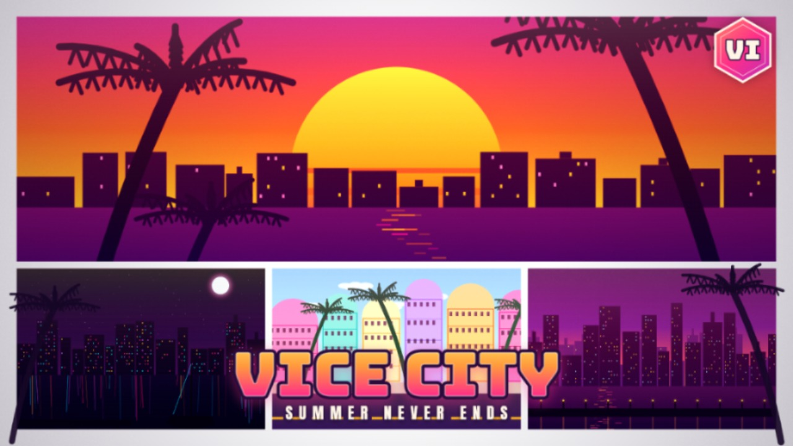
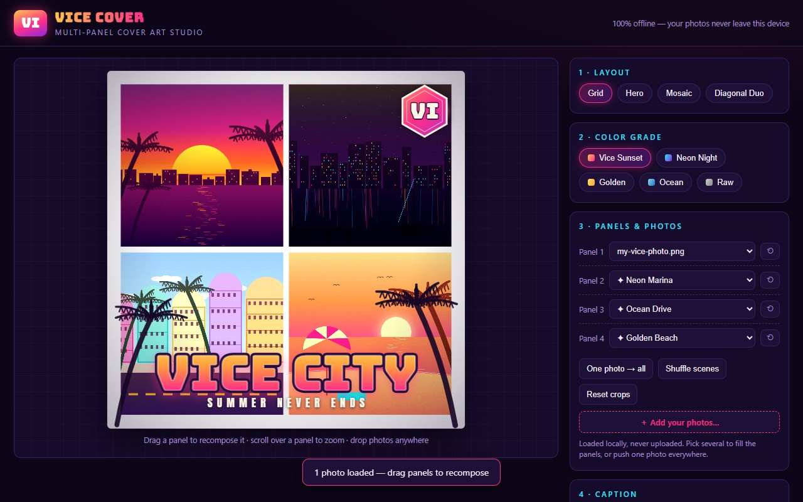
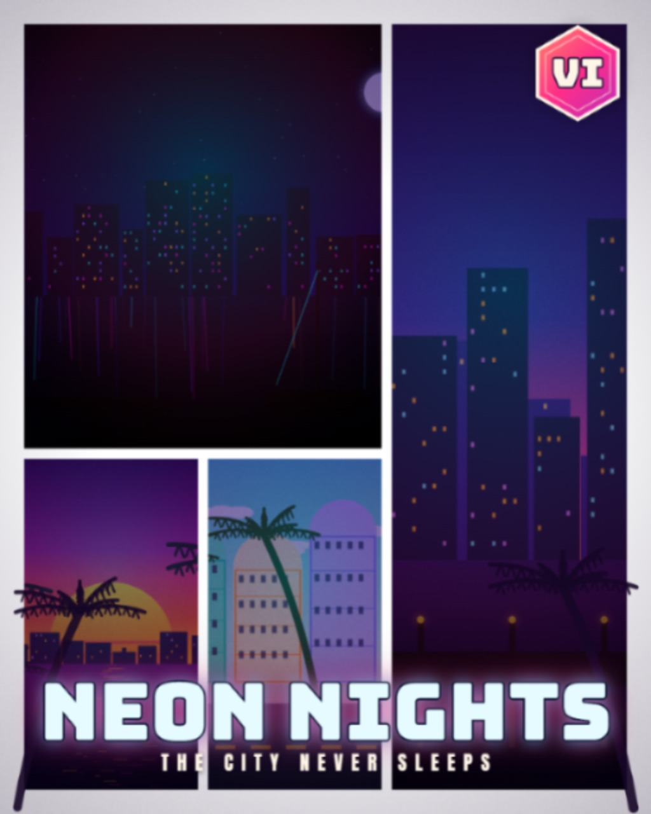
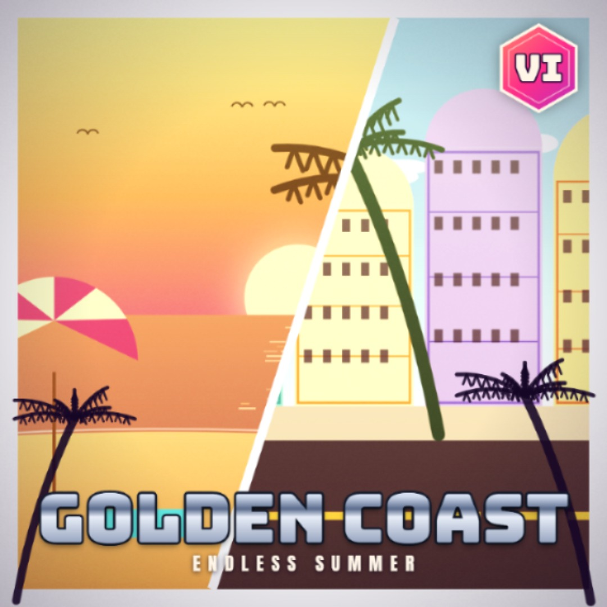

# Vice Cover — GTA-style multi-panel cover art studio

[](https://make.fun/bounty/gta6-cover-art-01)
[](https://make.fun/bounty/gta6-cover-art-01)
[](https://make.fun/bounty/gta6-cover-art-01)

**Owner:** Fliztone · **Entry:** `makefun-gta6-cover-art-01-fg4` · **Bounty:** [gta6-cover-art-01](https://make.fun/bounty/gta6-cover-art-01)

Vice Cover turns your own photos into striking GTA-style cover art: white-frame
multi-panel posters, bold Bungee caption lettering, Vice City sunset and neon
color grades, an original VI badge, palm silhouettes and seeded film grain —
exported as a PNG in the common post sizes. It is a fully static, offline web
app: every script, style, font and sample scene ships under `app/`, photos are
read on your own machine and never uploaded, and nothing touches the network.

## Screenshots

| Cover (wide, Vice sunset) | Editor with a photo loaded |
| --- | --- |
|  |  |

| Portrait, neon night | Square, golden diagonal duo |
| --- | --- |
|  |  |

All covers above were exported by the app itself (then scaled to fit the
bounty's screenshot caps). The sample "photos" are original procedural Vice
City scenes painted by `app/js/scenes.js` — no borrowed imagery, no Rockstar
assets.

## Features

- **4 white-frame layouts** — Grid, Hero, Mosaic and Diagonal Duo (`app/js/layouts.js`).
- **Per-panel crop** — drag any panel to recompose it, scroll to zoom, reset per panel.
- **5 color grades** — Vice Sunset, Neon Night, Golden, Ocean, Raw (`app/js/grades.js`).
- **Auto-fitted captions** — Bungee titles in Sunset / Neon / Chrome styles plus a tracked Anton tagline (`app/js/lettering.js`).
- **Original VI badge + palm silhouettes**, seeded film grain (`app/js/grain.js`).
- **Any photo** — load one or many local photos, fill several panels with one photo or several; five procedural sample scenes are built in.
- **One-click PNG export** at 1080×1080, 1080×1350 and 1920×1080.

## Run it

Any static file server works; with Node 22+:

```
node serve.ts          # serves app/ at http://localhost:8080
```

Open http://localhost:8080 in desktop Chrome or Edge. No build step, no
dependencies, no network requests.

## Hand-in program

`main.ts` (Node 22, standard library only) copies `app/` and `screenshots/`
into `$MAKEFUN_OUTPUT_DIR` (or `/output`) and writes `dossier.json` with the
kit's `buildDossier` from `vendor/makefun-app.ts`. Output is deterministic:
two runs write byte-identical files.

```
mkdir -p out && MAKEFUN_OUTPUT_DIR=out node main.ts
```

Screenshots are reproducible with `node tools/capture.mjs` (headless Edge via
playwright-core; serves `app/` over loopback for the capture only).

## Fonts

Bungee and Anton are shipped under `app/fonts/` with the SIL Open Font
License 1.1 (`app/fonts/OFL.txt`).

## License

MIT — see [LICENSE](LICENSE).
